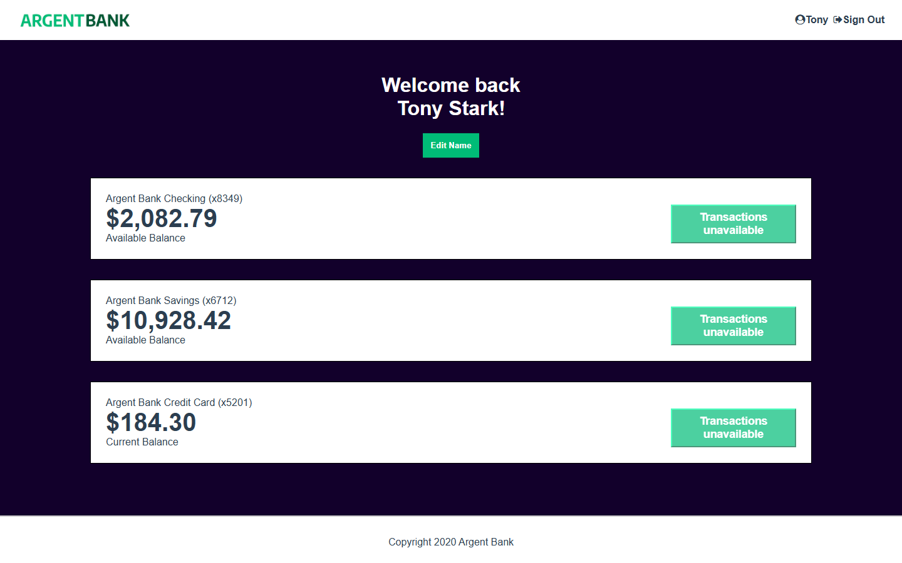

# Argent Bank

React and Redux Toolkit frontend for the OpenClassrooms Argent Bank project. Sign in with a demo account, open the protected profile, and edit the account holder’s name. The Express API saves the change in MongoDB.



The account balances are sample data. The [transaction API proposal](docs/swagger-transactions.yaml) describes a separate phase of the project. Transaction history and transaction edits are outside the current demo.

## Run locally

Use Node.js 24, npm, and a running MongoDB Community Server on port 27017. The defaults point to local services. Copy `.env.example` to `.env` if you need to change the database URL or API port. Use `frontend/.env.example` for a custom frontend API URL.

In the first terminal, from the repository root:

```sh
npm ci
npm run populate-db
npm run server
```

In a second terminal, from the same directory:

```sh
npm ci --prefix frontend
npm run frontend:dev
```

Open `http://localhost:5173/`. The API documentation is at `http://localhost:3001/api-docs`. The seed creates missing demo accounts and keeps existing profile edits when run again.

| Demo user | Email | Password |
| --- | --- | --- |
| Tony Stark | `tony@stark.com` | `password123` |
| Steve Rogers | `steve@rogers.com` | `password456` |

A regular session stays in the current browser tab. **Remember me** keeps it across browser restarts until the token expires or you sign out. By default, restarting the API signs out existing sessions. Set a private `SECRET_KEY` in the API environment to keep sessions across restarts.

## Verify

```sh
npm test
npm run frontend:build
```

The API tests use a temporary MongoDB database. Set `ARGENT_TEST_DATABASE_URL` to point them at a different local MongoDB instance. GitHub Actions runs the API tests and builds the frontend.

- `frontend/src/` contains the React routes, Redux state and API client.
- `server/` contains the Express routes and MongoDB models.
- `swagger.yaml` describes the implemented user API.
- `designs/` and `deliverables/` contain the supplied design references and coursework files.
